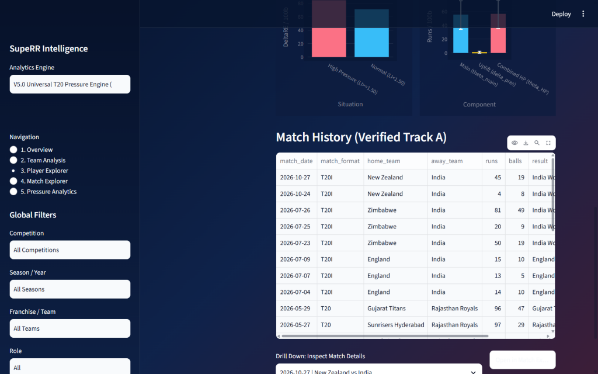

# SupeRR Intelligence — Universal T20 Pressure Performance Engine (V5.0)

## 1. Project Overview
SupeRR Intelligence is a research-grade cricket analytics platform for evaluating T20 batter and bowler performance after controlling for match context, opposition quality, innings state, venue/format par, and match leverage. **V5.0** provides a competition-independent T20 pressure engine across IPL and Men's T20I matches (2022–2026), while preserving **V4.2**, **V4.3**, and **V4.4** pipelines and artifacts.

## 2. Research Problem
Evaluate player performance under high-pressure match situations relative to baseline performance without confounding by phase, venue, innings, team strength, or opposition quality — and without fabricating missing extras or targets.

## 3. Evolution: V4.2 to V5.0
- **V4.2 (Provisional — Resource Stress):** Identified that raw `extras1_runs` is a categorical codebook (`1–7`), blocking score-aware WP; implemented Complete Penalized FWL + REML Empirical-Bayes on pre-delivery resource stress.
- **V4.3 (Observable-State & Batter-Run RAPM):** Formalized Phase 0–3 data-quality gates, Hierarchical EB venue/format par, cross-fitted `ER_batter(B, W)`, `DeltaRE_batter`, and joint batter–bowler Ridge RAPM (`alpha = 150.0`).
- **V4.4 (Cricsheet Reconciliation & Track A/B):** Reconciled `1,471 / 1,652` innings (`89.04%`) via 1-to-1 Cricsheet JSON matching; built score-aware Two-Innings WP, 12-outcome Expected Leverage Index (`LI`), `DeltaRE_total`, and Track B observable resource-pressure bridge.
- **V5.0 (Universal T20 Pressure Engine):** Introduced Asymmetric Block-Penalized Joint Ridge (`alpha_main = 250.0`, `alpha_int = 4000.0` via 1-SE rule), dual pressure scales (`LI_global`, `LI_innings`), paired bootstrap intervals for `theta_HP = theta_main + delta_pressure`, four mutually exclusive archetypes, and a 3-tab dashboard extension.

## 4. Data Sources & Coverage
- **Source Pack:** `853` matches (`837` with deliveries, `16` abandoned), `1,652` regular innings, `193,988` regular delivery rows (`185,951` legal deliveries), `4` Super Over matches (`26` rows isolated).
- **Cricsheet JSON Reconciliation (Track A):** `758 / 853` exact 1-to-1 match joins; **`1,471 / 1,652` verified innings** (`170,680` verified deliveries across `725` decided matches); **`181` blocked innings** excluded from Track A.

## 5. Track A vs Track B Distinction
- **Track A (Score-Aware Total-Run Target):** Uses Cricsheet-verified runs, targets, `LI_global`, `LI_innings`, and `DeltaRE_total` (separating non-bowler extras and non-bowler dismissals).
- **Track B (Observable Resource-State, Batter-Run-Only):** Covers all `193,988` regular deliveries using score-blind WP and `DeltaRE_batter`. Track A and Track B player coefficients are never merged.

## 6. Mathematical Methodology
- **Score-Aware WP:** Separate Innings 1 (`ProjectedFinalScore = CurrentScore + ER_total(B, W)`) and Innings 2 (`RunsRequired`, `RRR`, `CRR`, `wkts_rem`, `balls_rem`) dynamic logistic models in unified perspective `P(inn1_batting_team_wins)`.
- **Total-Run Value:** `DeltaRE_total = actual_total_runs + ER_total_after - ER_total_before`; player attribution removes `non_bowler_extras` (byes, leg-byes, delivery penalties) and separates `non_bowler_dismissal` events.

## 7. Two Leverage Scales
- **`LI_global = RawL_t / Mean(RawL_all_valid)`:** Absolute match win-probability leverage (`mean_raw_global = 0.015371`). Primary threshold: `LI_global >= 1.50` (`17.99%` of deliveries; `1.58%` in Inn 1, `36.18%` in Inn 2).
- **`LI_innings = RawL_t / Mean(RawL_same_innings)`:** Relative within-innings leverage (`mean_raw_inn1 = 0.010288`, `mean_raw_inn2 = 0.021000`).

## 8. Asymmetric Ridge Formulation
Minimizes `||y - X_main*theta - X_pressure*delta - X_context*gamma - b0||^2 + alpha_main*||theta||^2 + alpha_int*||delta||^2 + alpha_context*||gamma||^2` with training-fold-only standardization and 5-fold match-grouped CV + 1-SE selection (`alpha_main = 250.0`, `alpha_int = 4000.0`, `alpha_context = 250.0`). This separates the baseline main effect (`theta_main`), standalone pressure interaction (`delta_pressure`, experimental), and combined high-pressure performance (`theta_HP = theta_main + delta_pressure`, which correlates at `Spearman = 0.9909` with `theta_main` for batters and is therefore a combined performance score rather than a pure clutch ranking).

## 9. Player Archetypes
Mutually exclusive classification using paired 95% bootstrap CIs and `100/300/12` eligibility:
1. `ELITE CLUTCH PERFORMER` (`37` batters, `19` bowlers)
2. `CRISIS / RESCUE SPECIALIST` (`2` batters, `4` bowlers)
3. `PRESSURE-SENSITIVE GENERAL PERFORMER` (`0` batters, `0` bowlers)
4. `BELOW-AVERAGE UNDER PRESSURE` (`0` batters, `3` bowlers)
5. `UNCLASSIFIED / INSUFFICIENT EVIDENCE` (`50` batters, `56` bowlers + all ineligible players)

## 10. Eligibility Rules
Post-fit primary global gate: `n_HP >= 100`, `n_Total >= 300` (`is_ball_faced` for batters; all delivery events for bowlers), `m_HP >= 12` distinct HP matches (`89` batters, `82` bowlers eligible). Innings-split gate `(40, 150, 5)` is strictly exploratory.

## 11. Validation Methodology
5-fold match-grouped CV, chronological OOT (`> 2024`), `B = 200` paired match-cluster bootstrap (plus `B = 1,000` audit), `50` repeated match-level split-half tests, and V4.2/V4.3/V4.4 preservation checks.

## 12. Actual Measured Results
- **WP (Track A 5-Fold CV):** Inn 1 `AUC = 0.6986`, `Brier_eq = 0.2202`; Inn 2 `AUC = 0.8946`, `Brier_eq = 0.1257` (OOT `AUC = 0.9103`).
- **V5.0 Asymmetric Ridge:** 5-fold CV `MSE = 4.955498` (`RMSE = 2.226095`); OOT `MSE = 5.239541` (`RMSE = 2.289004`).
- **50-Split Stability:** Batters `hp_spearman = 0.2790`, `pres_spearman = 0.2265`, `top10_overlap = 5.48`; Bowlers `hp_spearman = 0.3631`, `pres_spearman = 0.1768`, `top10_overlap = 3.64`.

## 13. Statistical Limitations (Experimental Components)
- Standalone pressure-uplift slopes (`delta_pressure`) are **EXPERIMENTAL** due to finite high-pressure sample sizes (`50-split Spearman = 0.2265` batters, `0.1768` bowlers).
- `181 / 1,652` innings remain excluded from Track A due to missing/mismatched Cricsheet coverage.
- Out-of-sample future player-ranking prediction is not claimed beyond the tested OOT delivery MSE and split-half reliability metrics.

## 14. Installation
```powershell
python -m venv .venv
.venv\Scripts\activate
pip install -r requirements.txt
```

## 15. Dashboard UI Overview & Execution
Launch the interactive Streamlit dashboard:
```powershell
.venv\Scripts\streamlit.exe run dashboard/app.py
```
- **Engine Selector (`V4.2` Default / `V5.0` Selectable):** The sidebar **Analytics Engine** selector defaults to `V4.2 Provisional (Resource Stress)` to preserve V4.2 governance views, and switches to `V5.0 Universal T20 Pressure Engine (Track A)` for the Power BI-inspired 5-page analytics suite (`dashboard/ui_theme.py`, `dashboard/v5_0_panel.py`).
- **Global Filters:** Filter by Competition (`All Competitions`, `IPL (T20)`, `Men's T20I`), Season/Year (`2022–2026`), Franchise/Team, Role (`All`, `Batters`, `Bowlers`), or Player Search, with a one-click **Reset Filters** button.
- **Team → Player → Match Drill-Down Workflow:** Start on **Overview → TOP 10 PLAYERS** (`TOP 10 BATTERS` / `TOP 10 BOWLERS` tabs, governed by the `100/300/12` eligibility gate) or **Team Analysis**, select any player and click **Open Batter/Bowler Profile →** (or **View All Players →** for the full leaderboard), inspect their role-aware KPIs, 6 performance charts, and match history in **Player Explorer**, then click **Open in Match Explorer →** to view the exact ball-by-ball Win Probability and `LI_global` timeline.

### V5.0 Overview: Top Players, Ranking Reasons, Graphs & Player Comparison

The V5.0 Overview is intended to be read from the global dataset picture down to individual player evidence.

#### 1. Overview KPIs

The first row summarizes the active Track A filter scope with four live KPI cards:

- **Verified Matches (Track A)** — Cricsheet-reconciled matches in the selected filter scope.
- **Active Players** — unique batters and bowlers represented in the selected verified deliveries.
- **Verified Innings** — innings represented in the selected verified deliveries.
- **Verified Deliveries** — verified Track A delivery rows in the selected filter scope.

#### 2. Official Top 10 Players: Batters and Bowlers

The next major section is **TOP 10 PLAYERS**, with two separate tabs: **TOP 10 BATTERS** and **TOP 10 BOWLERS**. The lists are role-specific; batter and bowler values are not combined into one ranking.

The tables use the official V5.0 global pressure outputs:

- Batter source: `data/outputs/v5_0/V5_0_GLOBAL_BATTER_PRESSURE.csv`
- Bowler source: `data/outputs/v5_0/V5_0_GLOBAL_BOWLER_PRESSURE.csv`

Only players marked `eligible = True` are considered. The primary global eligibility gate is **100 high-pressure opportunities, 300 total role-specific opportunities, and 12 distinct high-pressure matches (100/300/12)**. The official order is taken from `rank_hp`; the UI does not manually rearrange the players or refit the model when filters change.

#### 3. Why These Players Are in the Top 10

Read the score components and exposure together:

- **Main effect (`theta_main`)** — the player's main performance contribution.
- **Pressure interaction (`delta_pressure`)** — the estimated additional pressure effect. This term remains **EXPERIMENTAL** because split-half reliability is weak.
- **Combined high-pressure estimate (`theta_HP`)** — calculated as `theta_main + delta_pressure`; the official leaderboard orders eligible players by this combined point estimate.
- **HP Balls and HP Matches** — the amount and spread of high-pressure exposure behind the estimate.
- **95% CI and Archetype** — uncertainty and the model's evidence-based player classification.

The combined HP leaderboard is a **main-performance estimate with a pressure adjustment**, not a pure clutch ranking. A higher point estimate or a higher adjacent rank does not establish statistical superiority. Overlapping individual 95% confidence intervals are not a paired player-to-player significance test.

##### Official Top 10 Batters

Effects are shown per 100 role-specific opportunities. Positive batter contribution indicates additional batter value under the model's sign convention.

| Rank | Batter | Main effect | Pressure interaction [EXP] | Combined HP (95% CI) | HP balls / matches | Why this player is placed here |
|---:|---|---:|---:|---:|---:|---|
| 1 | **Vaibhav Sooryavanshi** | +55.55 | +1.13 | **+56.68** ([+35.65, +76.46]) | 155 / 20 | Highest eligible batter combined estimate. The leading position is primarily driven by the strongest main effect in this list, with a small positive pressure adjustment. |
| 2 | **Abhishek Sharma** | +42.98 | -1.84 | **+41.14** ([+27.15, +53.51]) | 447 / 73 | Second-highest combined estimate. A very strong main effect keeps him second despite a negative pressure adjustment; he has the largest high-pressure exposure in this batter Top 10. |
| 3 | **Tim David** | +36.38 | +1.27 | **+37.65** ([+23.82, +50.50]) | 228 / 29 | Strong main contribution is increased by a positive pressure adjustment, giving the third-highest combined estimate. |
| 4 | **Finn Allen** | +34.32 | -0.84 | **+33.48** ([+16.71, +46.39]) | 125 / 32 | Fourth by combined estimate: a strong main effect is slightly reduced by a negative pressure adjustment. |
| 5 | **Suryakumar Yadav** | +31.28 | +0.37 | **+31.66** ([+24.23, +40.24]) | 331 / 36 | Fifth by combined estimate, with a strong main contribution and a small positive pressure adjustment supported by 331 high-pressure balls. |
| 6 | **Travis Head** | +31.12 | -0.95 | **+30.17** ([+15.09, +45.70]) | 276 / 44 | The negative pressure interaction reduces an otherwise strong main contribution, placing the combined estimate sixth. |
| 7 | **Heinrich Klaasen** | +28.17 | +1.28 | **+29.45** ([+19.26, +39.85]) | 116 / 14 | A positive pressure adjustment lifts the main contribution. He meets the primary gate with 116 high-pressure balls across 14 matches. |
| 8 | **Priyansh Arya** | +27.38 | -0.31 | **+27.06** ([+0.63, +51.01]) | 139 / 25 | Eighth by point estimate. The pressure adjustment is slightly negative and the confidence interval is wide, so this position carries substantial uncertainty. |
| 9 | **Phil Salt** | +26.11 | -0.92 | **+25.19** ([+13.44, +36.75]) | 413 / 59 | A large main contribution is partly reduced by the negative pressure interaction; 413 high-pressure balls across 59 matches provide substantial exposure. |
| 10 | **Nicholas Pooran** | +21.68 | +1.38 | **+23.06** ([+10.66, +32.99]) | 241 / 23 | A positive pressure adjustment adds to the main effect and keeps his combined estimate within the tenth position. |

##### Official Top 10 Bowlers

For bowlers, positive contribution means more runs prevented / stronger bowling-side value under the project's sign convention.

| Rank | Bowler | Main effect | Pressure interaction [EXP] | Combined HP (95% CI) | HP balls / matches | Why this player is placed here |
|---:|---|---:|---:|---:|---:|---|
| 1 | **Sunil Narine** | +32.81 | +0.61 | **+33.42** ([+24.78, +42.58]) | 214 / 21 | Highest eligible bowler combined estimate, driven by the strongest main run-prevention contribution in the list plus a positive pressure adjustment. |
| 2 | **Jasprit Bumrah** | +31.40 | +0.23 | **+31.63** ([+22.46, +42.32]) | 342 / 30 | Second-highest combined estimate, close to the leader, with a strong main contribution and a small positive adjustment. |
| 3 | **Abrar Ahmed** | +24.40 | +0.62 | **+25.02** ([+10.59, +38.39]) | 149 / 13 | A positive pressure adjustment adds to his main bowling contribution, placing him third among eligible bowlers. |
| 4 | **Kuldeep Yadav** | +21.88 | -0.20 | **+21.68** ([+12.02, +33.73]) | 209 / 21 | Fourth by combined estimate. His strong main contribution is marginally reduced by the pressure interaction. |
| 5 | **Varun Chakravarthy** | +20.60 | -0.37 | **+20.23** ([+10.84, +28.49]) | 280 / 25 | Fifth by combined estimate; the negative pressure adjustment slightly reduces the main run-prevention contribution. |
| 6 | **Josh Hazlewood** | +18.73 | +0.39 | **+19.11** ([+5.59, +31.53]) | 366 / 31 | A positive pressure adjustment adds to the main effect. The 366 high-pressure balls provide exposure, while the interval remains comparatively wide. |
| 7 | **Bhuvneshwar Kumar** | +16.47 | +0.61 | **+17.08** ([+7.14, +25.78]) | 679 / 77 | A positive pressure adjustment lifts the main contribution; 679 high-pressure balls across 77 matches give the largest exposure base in this bowler Top 10. |
| 8 | **Rashid Khan** | +15.82 | +0.46 | **+16.28** ([+4.16, +29.26]) | 177 / 15 | The positive pressure adjustment adds to his main effect and produces the eighth-highest combined estimate. |
| 9 | **Mustafizur Rahman** | +16.66 | -0.54 | **+16.12** ([+7.23, +26.21]) | 232 / 23 | His main effect is higher than Rashid Khan's, but a negative pressure adjustment reduces the combined estimate slightly below Rashid's. |
| 10 | **Mohsin Khan** | +15.54 | +0.38 | **+15.92** ([-0.01, +31.82]) | 200 / 19 | A positive pressure adjustment places him tenth by point estimate. His confidence interval crosses zero and his archetype is **UNCLASSIFIED / INSUFFICIENT EVIDENCE**, so the rank should be interpreted cautiously. |

#### 4. Top 10 Ranking Graphs

The Overview contains two separate horizontal bar charts:

- **Top Batters — Combined HP (`theta_HP`, 95% CI):** one bar per eligible batter, with an error bar spanning the player's combined HP confidence interval.
- **Top Bowlers — Combined HP Prevention (95% CI):** the equivalent role-specific view for bowlers, using the bowling-side run-prevention sign convention.

These graphs compare point estimates and uncertainty. A longer bar does not, by itself, establish that one player is statistically better than another.



#### 5. Player Explorer — Individual Performance & Comparison

After choosing a player from the Top 10 tables or Player Explorer's **Quick Jump: Official Top 10**, the profile shows role-aware KPIs and six charts:

1. **Year-by-Year Performance:** annual runs for a batter or wickets for a bowler.
2. **Career Cumulative Progression:** cumulative runs or wickets across the player's verified innings.
3. **Innings Performance Distribution:** the distribution of runs per innings or wickets per innings.
4. **Competition Comparison:** the selected player's raw `DeltaRE` contribution per 100 balls across available competition formats.
5. **Pressure vs Normal Performance:** the selected player's unadjusted `DeltaRE` contribution per 100 balls in `LI_global >= 1.50` versus normal-pressure deliveries.
6. **V5.0 Effects & 95% Paired Bootstrap CIs:** side-by-side `theta_main`, `delta_pressure`, and `theta_HP` estimates with their confidence intervals.

This is a within-player comparison across time, format, and pressure context. The current dashboard does **not** provide a separate two-player head-to-head comparison selector. Match history appears below the charts, with **Open in Match Explorer →** for verified match drill-down.

| Dashboard Page | Features |
|---|---|
| Overview | Global cricket analytics, team wins vs win %, season scoring trends, top batter/bowler HP leaderboards, competition boxplots, archetype distribution |
| Team Analysis | Team KPIs, season evolution, batting vs bowling `DeltaRE` contribution, key batters/bowlers, `TEAM → PLAYER` drill-down |
| Player Explorer | Left filter panel, initials avatar profile, role-aware KPI strip, 6 performance charts, match history, `PLAYER → MATCH` drill-down |
| Match Explorer | Verified Track A match metadata, WP & `LI_global >= 1.50` timeline, phase-level runs/wickets, batting & bowling match contributions |
| Pressure Analytics | V5.0 3-tab suite: Global T20 Pressure Leaderboard, Match Pressure Analysis (Track A only), Optional Franchise/Squad View |

**UI & Data Limitations:** Unavailable player/match metrics are displayed as `N/A` (never false zeros). Match Explorer and Match Pressure Analysis display only the `170,680` Cricsheet-verified Track A deliveries (`725` matches); the `181 / 1,652` blocked/unverified innings are excluded and Track B resource proxies are never presented as verified match events.

## 16. Pipeline & Testing Commands
```powershell
.venv\Scripts\python.exe scripts/run_v4_3_phases_0_to_3.py
.venv\Scripts\python.exe scripts/run_v4_3_phases_3_5_to_7.py
.venv\Scripts\python.exe scripts/run_v4_4_pipeline.py
.venv\Scripts\python.exe scripts/run_v5_0_pipeline.py
.venv\Scripts\python.exe -m pytest tests/test_ui_governance.py -v
.venv\Scripts\python.exe -m pytest tests/test_v5_0/ -v
.venv\Scripts\python.exe -m pytest tests/test_v4_4/ tests/test_v4_3/ -v
.venv\Scripts\python.exe scripts/verify_v4_2_rankings.py
```

## 17. Directory Structure
- `src/v4_2/`, `src/v4_3/`, `src/v4_4/`, `src/v5_0/` — Versioned analytics engines
- `data/outputs/v4_2/`, `v4_3/`, `v4_4/`, `v5_0/` — Versioned outputs & audit artifacts
- `dashboard/` — Streamlit UI (`app.py`, `v5_0_panel.py`, `charts.py`, `data_loader.py`)
- `tests/` — Automated invariant, governance, and UI tests

## 18. References
- Brooker & Hogan (2012) — WASP; Asif & McHale (2016) — Dynamic Logistic WP; Davis, Perera & Swartz (2015) — T20 Run Differential; Sill (2010) — Ridge RAPM; Bhattacharjee & Lemmer (2016); Bandyopadhyay & Bhattacharjee (2025, arXiv:2505.01849); Cricsheet JSON open cricket data (`https://cricsheet.org/`).
