# Existing Pipeline Dependency Map: SupeRR Intelligence V2 to V3
**Document Code:** AGY-V3-DEP-001  
**Date:** November 2026

---

## 1. Overview of Pipeline Architecture

The SupeRR Intelligence platform processes raw ball-by-ball, match, playing eleven, and tournament metadata into high-dimensional cricket intelligence features, pressure classifications, ranking leaderboards, and tactical scouting outputs.

This document traces the exact data flow, script dependencies, file inputs, and derived outputs across the entire pipeline.

---

## 2. End-to-End Pipeline Execution Graph

```mermaid
flowchart TD
    %% Source Data
    subgraph Raw Data [data/]
        CSV1[(ball_by_ball_ipl_t20i.csv)]
        CSV2[(matches_ipl_t20i.csv)]
        CSV3[(playing_eleven_ipl_t20i.csv)]
        CSV4[(competition_team_player_mapping_ipl_t20i.csv)]
        CSV5[(competitions_ipl_t20i.csv)]
        CSV6[(teams_ipl_t20i.csv)]
    end

    %% Phase 1
    subgraph Step 1: Cleaning & Ingestion
        S1[scripts/validate_phase1.py]
        CSV1 & CSV2 & CSV3 --> S1
        S1 --> P1[(data/processed/ball_by_ball_cleaned.parquet)]
        S1 --> P2[(data/processed/playing_eleven_cleaned.parquet)]
        S1 --> P3[(data/processed/super_overs.parquet)]
    end

    %% Phase 2
    subgraph Step 2: Context Building
        S2[scripts/build_context.py]
        P1 & P2 & CSV2 --> S2
        S2 --> P4[(data/features/ball_by_ball_with_context.parquet)]
    end

    %% Phase 3
    subgraph Step 3: Cricket Statistics
        S3[scripts/compute_cricket_stats.py]
        P4 & CSV4 --> S3
        S3 --> P5[(data/features/batter_stats.parquet)]
        S3 --> P6[(data/features/bowler_stats.parquet)]
        S3 --> P7[(data/features/batter_phase_stats.parquet)]
        S3 --> P8[(data/features/bowler_phase_stats.parquet)]
        S3 --> P9[(data/features/matchups.parquet)]
        S3 --> P10[(data/features/venue_stats.parquet)]
    end

    %% Phase 4 & 5
    subgraph Step 4: Pressure Modeling & Rankings
        S4[scripts/compute_rankings.py]
        P4 & P2 & CSV4 --> S4
        S4 --> P11[(data/features/ball_by_ball_with_pressure.parquet)]
        S4 --> OUT1[(data/outputs/FINAL_TOP_10_BATTERS.csv)]
        S4 --> OUT2[(data/outputs/FINAL_TOP_10_BOWLERS.csv)]
        S4 --> OUT3[(data/outputs/ALL_BATTER_RANKINGS.csv)]
        S4 --> OUT4[(data/outputs/ALL_BOWLER_RANKINGS.csv)]
        S4 --> OUT5[(data/outputs/PLAYER_ROLE_CLASSIFICATION.csv)]
    end

    %% Phase 6
    subgraph Step 5: RR Squad Scouting
        S5[scripts/run_scouting.py]
        P4 & CSV4 --> S5
        S5 --> OUT6[(data/outputs/RR_SQUAD_SCOUTING_REPORT.csv)]
        S5 --> OUT7[(data/outputs/scouting_explosive_middle_order.csv)]
        S5 --> OUT8[(data/outputs/scouting_indian_fast_bowlers.csv)]
    end

    %% Step 6
    subgraph Step 6: Streamlit Dashboard & Reporting
        S6[src/reporting/report_generator.py]
        S7[dashboard/app.py]
        OUT1 & OUT2 & OUT3 & OUT4 & OUT5 & OUT6 --> S6
        OUT1 & OUT2 & OUT3 & OUT4 & OUT5 & OUT6 --> S7
    end
```

---

## 3. Script-by-Script Dependency Matrix

### 3.1 `scripts/validate_phase1.py`
- **Module Under Test:** `src/ingestion/loader.py`, `src/preprocessing/cleaner.py`
- **Input Data:**
  - `data/ball_by_ball_ipl_t20i.csv` (194,014 rows)
  - `data/matches_ipl_t20i.csv` (853 rows)
  - `data/playing_eleven_ipl_t20i.csv` (27,393 rows)
  - `data/VALIDATION_COUNTS.json`
- **Transformations Applied:**
  - Extras classification: categorical mapping via `EXTRAS_TYPE_MAP`.
  - Balls faced flag: `is_ball_faced = extras_category != 'wide'`.
  - Legal ball flag: `is_legal_ball = ~extras_category.isin({'wide', 'Overstep'})`.
  - Boundary reconciliation: 20 fours and 3 sixes corrected without mutating raw flags.
  - Bowler wicket classification: excludes non-bowler dismissals (`RunOut`, `Retire Out`, `Obstructing the field`).
  - Super Over segregation: innings 3 & 4 (26 balls) split off.
  - Deduplication of playing-eleven conflicts (keeping lowest batting order).
- **Outputs Created:**
  - `data/processed/ball_by_ball_cleaned.parquet` (193,988 rows)
  - `data/processed/playing_eleven_cleaned.parquet` (27,358 rows)
  - `data/processed/super_overs.parquet` (26 rows)

### 3.2 `scripts/build_context.py`
- **Module Under Test:** `src/context_engine/innings_context.py`, `delivery_context.py`, `partnership_tracker.py`
- **Input Data:**
  - `data/processed/ball_by_ball_cleaned.parquet`
  - `data/processed/playing_eleven_cleaned.parquet`
  - `data/matches_ipl_t20i.csv`
- **State Engines Evaluated:**
  - `InningsContextTracker`: Tracks wickets fallen before, batter balls faced before, striker/non-striker runs.
  - `DeliveryContextTracker`: Rolling 12-ball windows for dots, boundaries, wickets, and consecutive dots.
  - `PartnershipTracker`: Tracks cumulative partnership runs and balls per wicket stand.
- **Outputs Created:**
  - `data/features/ball_by_ball_with_context.parquet` (193,988 rows, 68 columns)

### 3.3 `scripts/compute_cricket_stats.py`
- **Module Under Test:** `src/cricket_engine/batter_analysis.py`, `bowler_analysis.py`, `matchup_analysis.py`, `venue_analysis.py`
- **Input Data:**
  - `data/features/ball_by_ball_with_context.parquet`
  - `data/competition_team_player_mapping_ipl_t20i.csv`
- **Aggregations Computed:**
  - Career aggregates (balls faced, runs, dismissals, strike rate, boundaries).
  - Innings phase splits (Powerplay, Middle, Death).
  - Head-to-head batter vs. bowler matchups.
  - Venue baseline run rates and phase profiles.
- **Outputs Created:**
  - `data/features/batter_stats.parquet`
  - `data/features/bowler_stats.parquet`
  - `data/features/batter_phase_stats.parquet`
  - `data/features/bowler_phase_stats.parquet`
  - `data/features/matchups.parquet`
  - `data/features/venue_stats.parquet`

### 3.4 `scripts/compute_rankings.py`
- **Module Under Test:** `src/pressure_engine/pressure_model.py`, `src/classification/role_classifier.py`, `src/ranking_engine/pressure_rankings.py`
- **Input Data:**
  - `data/features/ball_by_ball_with_context.parquet`
  - `data/processed/playing_eleven_cleaned.parquet`
  - `data/competition_team_player_mapping_ipl_t20i.csv`
- **Models Executed:**
  - Batting Crisis Model (0–10) & Bowling Defensive Model (0–10).
  - Role classification and canonical name standardization.
  - Normal-Normal & Beta-Binomial Empirical Bayes shrinkage.
  - Exposure-adjusted consistency score computation.
  - PRI calculation across 5 weighting sensitivity scenarios.
- **Outputs Created:**
  - `data/features/ball_by_ball_with_pressure.parquet`
  - `data/outputs/FINAL_TOP_10_BATTERS.csv`
  - `data/outputs/FINAL_TOP_10_BOWLERS.csv`
  - `data/outputs/ALL_BATTER_RANKINGS.csv`
  - `data/outputs/ALL_BOWLER_RANKINGS.csv`
  - `data/outputs/LOWER_ORDER_PRESSURE_IMPACT.csv`
  - `data/outputs/EMERGING_AND_PART_TIME_BOWLERS.csv`
  - `data/outputs/PLAYER_ROLE_CLASSIFICATION.csv`
  - `data/outputs/PLAYER_NAME_ALIASES.csv`
  - `data/outputs/PLAYER_ELIGIBILITY_REPORT.csv`
  - `data/outputs/PRI_SENSITIVITY_ANALYSIS.csv`
  - `data/outputs/PRESSURE_MODEL_VALIDATION.csv`

### 3.5 `scripts/run_scouting.py`
- **Module Under Test:** `src/scouting_engine/rr_scouting.py`
- **Input Data:**
  - `data/features/ball_by_ball_with_context.parquet`
  - `data/competition_team_player_mapping_ipl_t20i.csv`
- **Scouting Modules Evaluated:**
  - Explosive No. 4/5 middle-order batters.
  - Verified Indian pace depth (separating international caps from domestic pool).
  - Powerplay pace, middle-over pace, and death bowling reliability.
  - Spin support for Ravindra Jadeja and Ravi Bishnoi.
  - On-field partnership analysis (Parag, Ferreira, Jadeja).
- **Outputs Created:**
  - `data/outputs/RR_SQUAD_SCOUTING_REPORT.csv`
  - `data/outputs/scouting_explosive_middle_order.csv`
  - `data/outputs/scouting_indian_fast_bowlers.csv`
  - `data/outputs/scouting_powerplay_pace.csv`
  - `data/outputs/scouting_middle_over_pace.csv`
  - `data/outputs/scouting_death_bowlers.csv`
  - `data/outputs/scouting_spin_support.csv`
  - `data/outputs/scouting_batting_combo_profiles.csv`
  - `data/outputs/scouting_batting_combo_partnerships.csv`

---

## 4. V3 Migration Pipeline Extensions

The V3 framework introduces new versioned execution scripts under `scripts/` with outputs targeted strictly to `data/outputs/v3/`:

1. `scripts/audit_and_reconcile_data.py` (Phase 0 & 1 audit, cohort manifest, quarantined records).
2. `scripts/build_rr_2026_analysis.py` (Phase 11 & 12 dedicated RR 2026 match-level & phase analysis).
3. `src/classification/v3_role_classifier.py` (Phase 2 five-state classification).
4. `src/pressure_engine/v3_pressure_model.py` (Phase 4 dual pressure engine).
5. `src/models/v3_joint_performance.py` (Phase 5 hierarchical regression engine).
6. `src/models/v3_wicket_hazard.py` (Phase 6 discrete-time hazard model).
7. `src/models/v3_tail_risk.py` (Phase 7 bowling tail-risk & CVaR engine).
8. `src/models/v3_lightgbm_challenger.py` (Phase 8 challenger model).
9. `src/reliability/v3_reliability.py` (Phase 9 match-clustered bootstrap engine).
10. `src/scouting_engine/v3_rr_player_fit.py` (Phase 13–15 squad gap & auction optimization).
11. `dashboard/app.py` (Phase 16 integrated 5-section UI).
