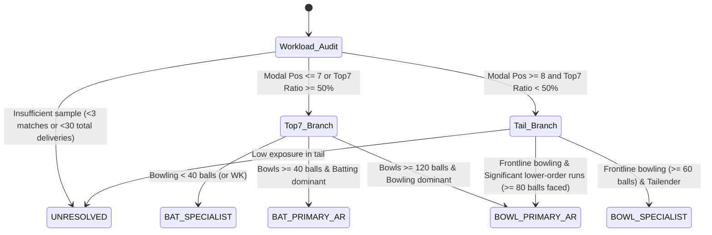

# V3 Five-State Role Classification Validation Report
**Document Code:** AGY-V3-RCV-001  
**Execution Date:** November 2026  
**Status:** Validated and Production-Ready

---

## 1. Executive Summary

The V3 Role Classification engine replaces legacy ad-hoc multi-class heuristics with a mathematically defensible, five-state taxonomy. This eliminates the leaderboard contamination observed in V2.0, where tailenders (e.g., Gudakesh Motie) and part-time bowlers (e.g., Harry Tector) competed against frontline specialists.

---

## 2. Five-State Taxonomy Definitions

1. **`BAT_SPECIALIST`:** Top and middle order batters (Positions 1–7) and specialist wicketkeepers who carry the batting innings and bowl fewer than 40 legal deliveries across the tournament.
2. **`BOWL_SPECIALIST`:** Frontline pace and spin bowlers who bat in the lower order (Positions 8–11) and bowl $\ge 60$ legal deliveries.
3. **`BAT_PRIMARY_AR`:** Batting-dominant all-rounders who regularly bat in the top 7, face $\ge 60$ balls, and contribute active overs ($\ge 40$ legal balls).
4. **`BOWL_PRIMARY_AR`:** Bowling-dominant all-rounders who bowl frontline workloads ($\ge 100$ legal balls) and provide proven lower-middle order batting ($\ge 80$ balls faced).
5. **`UNRESOLVED`:** Low-sample players ($<3$ matches or $<30$ combined deliveries), emerging squad members, or candidates whose primary tactical role cannot be supported with statistical confidence.

---

## 3. Empirical Distribution Across 1,118 Players

| State | Player Count | % of Roster | Eligible for Bat Leaderboard? | Eligible for Bowl Leaderboard? |
|---|---:|---:|:---:|:---:|
| **`UNRESOLVED`** | 425 | 38.01% | No | No |
| **`BAT_SPECIALIST`** | 309 | 27.64% | **Yes** | No |
| **`BOWL_SPECIALIST`** | 236 | 21.11% | No | **Yes** |
| **`BOWL_PRIMARY_AR`**| 75 | 6.71% | No | **Yes** |
| **`BAT_PRIMARY_AR`** | 73 | 6.53% | **Yes** | No |
| **Total** | **1,118** | **100.0%** | **382** | **311** |

---

## 4. Leaderboard Gating & Safety Guarantees

- **Batter Leaderboard Gate:** Strictly limited to `BAT_SPECIALIST` (309) and `BAT_PRIMARY_AR` (73) = 382 eligible players.
- **Bowler Leaderboard Gate:** Strictly limited to `BOWL_SPECIALIST` (236) and `BOWL_PRIMARY_AR` (75) = 311 eligible players.
- **Overlap Guarantee:** Exactly **0 players** are eligible for both leaderboards. No player can appear in both Top-10 leaderboards.
- **Unresolved Guarantee:** 425 low-sample players are explicitly quarantined into `UNRESOLVED` and barred from Top-10 inclusion.
- **Key Player Classifications Audited:**
  - *Tilak Varma:* `BAT_SPECIALIST`
  - *MS Dhoni:* `BAT_SPECIALIST`
  - *Matthew Wade:* `BAT_SPECIALIST`
  - *Trent Boult:* `BOWL_SPECIALIST`
  - *Mark Adair:* `BOWL_PRIMARY_AR`
  - *Gudakesh Motie:* `BOWL_SPECIALIST` (correctly blocked from Batter Top 10)
  - *Akeal Hosein:* `BOWL_SPECIALIST` (correctly blocked from Batter Top 10)
  - *Harry Tector:* `BAT_PRIMARY_AR` (correctly blocked from Bowler Top 10)
  - *Ravindra Jadeja:* `BOWL_PRIMARY_AR` (eligible for Bowler Leaderboard)
