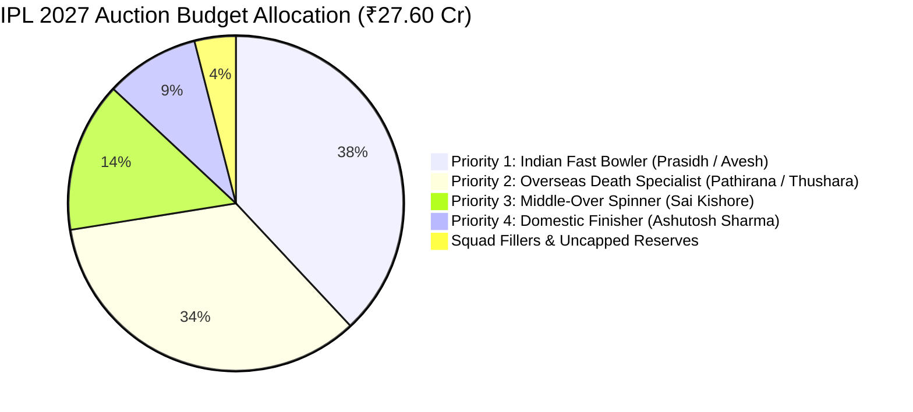

# Rajasthan Royals IPL 2027 Auction Strategy & Purse Optimization
**Document Code:** AGY-V3-AS-001  
**Target Auction:** IPL 2027 Mini-Auction (16 December 2026, Goa)  
**Retention Deadline:** 17 November 2026  
**Execution Date:** November 2026  
**Status:** Strategy Formulated with Verified Arithmetic Constraints

---

## 1. Purse Arithmetic & Cap Scenarios

The baseline financial modeling evaluates two macro purse scenarios:

| Metric | Base Cap Scenario | Expanded Cap (+₹5 Cr) Scenario | Verification Status |
|---|---:|---:|---|
| **Carried-Over Purse from 2026** | ₹2.65 Cr | ₹2.65 Cr | USER_PROVIDED_UNVERIFIED |
| **Salary Freed via Proposed Releases** | ₹24.95 Cr | ₹24.95 Cr | DERIVED_SCENARIO |
| **Salary Cap Growth** | ₹0.00 Cr | ₹5.00 Cr | UNVERIFIED_SCENARIO |
| **Total Available Auction Purse** | **₹27.60 Cr** | **₹32.60 Cr** | DERIVED_SCENARIO |
| **Total Roster Slots Vacated** | 6 | 6 | Squad shrinks from 25 to 19 |
| **Overseas Slots Vacated** | 3 | 3 | Hetmyer, Milne, Pretorius released |

---

## 2. Release Candidate Breakdown

The release recommendations are justified strictly by performance-to-cost return in IPL 2026:

1. **Shimron Hetmyer (Freed: ₹11.00 Cr, Overseas):** Scored only 78 runs in 8 matches (average 13.00, strike rate 113.04). Releasing Hetmyer unlocks 40% of RR's total auction budget and frees an overseas slot.
2. **Tushar Deshpande (Freed: ₹6.50 Cr, Indian):** Took 4 wickets in 7 games at high boundary concession.
3. **Sandeep Sharma (Freed: ₹4.00 Cr, Indian):** Managed only 5 wickets in 6 games with persistent back-end execution issues.
4. **Adam Milne (Freed: ₹2.40 Cr, Overseas):** Featured in only 1 match without a wicket; occupies a critical overseas roster spot.
5. **Kuldeep Sen (Freed: ₹75 L, Indian):** Missed the season due to persistent injury.
6. **Lhuan-dre Pretorius (Freed: ₹30 L, Overseas):** Unused overseas development wicketkeeper.

**Total Salary Released:** ₹11.00 + ₹6.50 + ₹4.00 + ₹2.40 + ₹0.75 + ₹0.30 = **₹24.95 Cr**.

---

## 3. Critical Contract Status Conflict Disclosure

> [!WARNING]
> **Sam Curran vs. Dasun Shanaka Contract Conflict:**
> - The user brief notes that Dasun Shanaka (₹2.00 Cr) was signed as a temporary replacement for Sam Curran (groin injury).
> - However, the brief also lists Sam Curran among the retained core top seven.
> - Under IPL governing rules, a franchise cannot simultaneously hold both a registered injured player and an active replacement player on the permanent roster into the subsequent season without formally clarifying Curran's medical clearance and contract reactivation.
> - **Actionable Recommendation:** RR management must confirm Curran's fitness before the 17 November retention deadline. If Curran is retained, Shanaka’s contract terminates automatically. If Curran is not retained, RR gains additional purse flexibility.

---

## 4. Auction Allocation & Acquisition Game Plan

### Primary Plan: Base Purse Scenario (₹27.60 Cr)

1. **Priority 1 — Indian Fast Bowler (Target: Prasidh Krishna / Avesh Khan):** Bid up to ₹10.50 Cr. Securing an Indian frontline pacer to partner Archer is non-negotiable.
2. **Priority 2 — Overseas Death Bowler (Target: Matheesha Pathirana / Nuwan Thushara):** Bid up to ₹9.50 Cr for Pathirana. If Pathirana exceeds ₹11.00 Cr in a bidding war, immediately pivot to Nuwan Thushara at ₹4.50–₹5.50 Cr.
3. **Priority 3 — Middle Spinner (Target: R Sai Kishore):** Bid up to ₹4.00 Cr for Sai Kishore to lock down left-arm finger spin control.
4. **Priority 4 — Domestic Finisher (Target: Ashutosh Sharma):** Allocate ₹2.50 Cr to secure Ashutosh as the designated No. 6/7 boundary striker.
5. **Reserve Balance:** ₹1.10 Cr allocated across uncapped domestic players to reach the mandatory 25-man squad size.

---

## 5. Projected Strongest Rajasthan Royals Playing XI (IPL 2027)

1. **Yashasvi Jaiswal** (LHB)
2. **Vaibhav Sooryavanshi** (LHB)
3. **Dhruv Jurel** (RHB, Wicketkeeper)
4. **Riyan Parag** (RHB, Captain)
5. **Donovan Ferreira** ✈️ (RHB, Finisher)
6. **Ashutosh Sharma** / **Abhinav Manohar** (RHB, Finisher)
7. **Ravindra Jadeja** (LHB, Slow Left-Arm Orthodox)
8. **R Sai Kishore** (LHB, Slow Left-Arm Orthodox) / **Ravi Bishnoi** (Leg-break)
9. **Jofra Archer** ✈️ (Right-Arm Fast)
10. **Prasidh Krishna** / **Avesh Khan** (Right-Arm Fast)
11. **Matheesha Pathirana** ✈️ / **Nuwan Thushara** ✈️ (Right-Arm Fast Sling)
*Impact Sub:* **Brijesh Sharma** (Mystery Spin) / **Nandre Burger** ✈️ (Left-Arm Pace)
