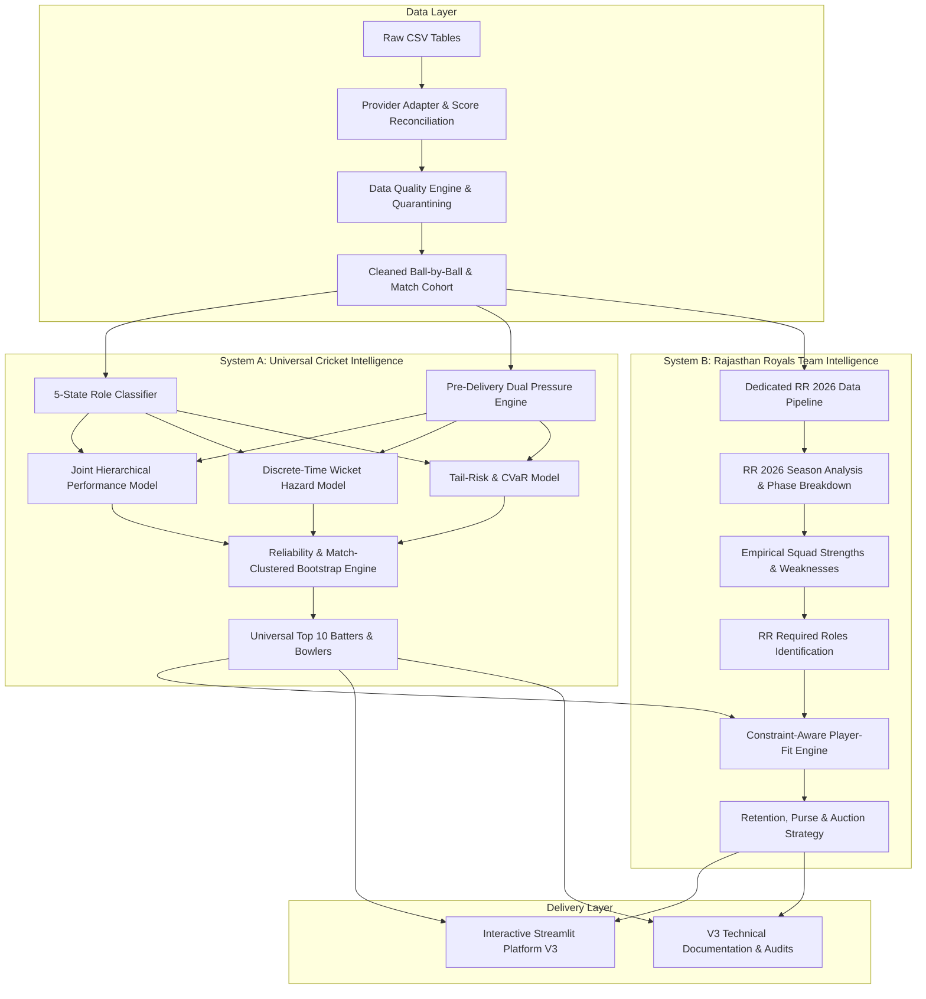

# V2 to V3 Migration Audit: SupeRR Intelligence Platform
**Author:** SupeRR Data Science & Engineering Team  
**Date:** November 2026  
**Version:** V3.0-Production Readiness  
**Target:** Rajasthan Royals SupeRR Selector Season 2 Hackathon

---

## 1. Executive Summary

SupeRR Intelligence 2.0 provided an initial framework for evaluating cricket performance under pressure using a Pressure Reliability Index (PRI). However, an exhaustive audit reveals fundamental methodological and data-engineering limitations that prevent V2.0 from serving as a scientifically defensible, production-grade intelligence platform:

1. **Rigid Composite PRI with Arbitrary Fixed Weights:** PRI combined maintenance (0.35), absolute pressure capability (0.35), cross-match consistency (0.20), and sample confidence (0.10) into a single scalar index without statistical validation of the weight simplex or sensitivity to non-linear trade-offs.
2. **Conflated Batter-Bowler Leaderboards & Role Spillover:** Tailenders and specialist bowlers with small batting samples (e.g., Gudakesh Motie, Akeal Hosein) and part-time bowlers with few deliveries (e.g., Harry Tector) entered primary leaderboards due to incomplete role separation.
3. **Absence of Joint Performance Modeling:** Batter and bowler effects were estimated in isolation, ignoring the bilateral matchup network ($Y_t = \alpha + X_t\beta + a_i + b_j + H_t(u_i + v_j) + \epsilon_t$) and selection biases in delivery face-offs.
4. **Wicket Modeling Conflation:** Wickets were treated through heuristic rates or ad-hoc additive scores rather than a calibrated discrete-time hazard model separating bowler-creditable dismissals from run-outs and retirements.
5. **Score Reconstruction & Extras Semantic Fragility:** `extras1_runs` is a categorical code (1–7), not a run tally, and `runs` represents batter runs off the bat, not total team delivery runs. Previous derivations of bowler economy and required run rate (RRR) risked invalid run summation.
6. **Decoupled RR Scouting vs. Universal Rankings:** Previous scouting recommendations relied on heuristic filters rather than a structured two-system framework: System A (Universal Rankings) and System B (Rajasthan Royals Squad Requirements & Constraint-Aware Player-Fit).

This document establishes the baseline audit, code paths, and architectural roadmap for migrating to V3.

---

## 2. Code Paths and Function Dependencies Audit

| Component | Source File | Key Functions | Audit Status / Known Vulnerabilities |
|---|---|---|---|
| **Configuration** | `src/config.py` | Constants, path mapping, `EXTRAS_TYPE_MAP` | Validated paths and enum map (Codes 1–7). |
| **Ingestion** | `src/ingestion/loader.py` | `load_all_data()`, `_validate_row_counts()` | Requires dtype overrides for season column. Checks row counts against `VALIDATION_COUNTS.json`. |
| **Preprocessing** | `src/preprocessing/cleaner.py` | `clean_all()`, `classify_extras()`, `identify_balls_faced()`, `identify_legal_balls()`, `validate_boundaries()`, `classify_bowler_wickets()`, `resolve_playing_xi_conflicts()` | Fixed 23 boundary discrepancies; resolves playing-XI conflicts by sorting `batting_order` ascending. Separates 26 super-over balls. |
| **Context Engine** | `src/context_engine/innings_context.py`, `delivery_context.py`, `partnership_tracker.py` | State tracking: balls faced, wickets before, dots in 12, boundaries in 12 | Pre-delivery state correctly maintained with zero target leakage. |
| **Cricket Engine** | `src/cricket_engine/batter_analysis.py`, `bowler_analysis.py`, `matchup_analysis.py` | Aggregate career and phase stats | Computes phase volumes and dot percentages. Economy metrics must be quarantined due to extras semantics. |
| **Role Classifier** | `src/classification/role_classifier.py` | `classify_player_roles()`, `build_player_name_aliases()` | Currently generates 10+ granular roles with ad-hoc heuristics. Needs replacement by V3 Five-State Classifier. |
| **Pressure Engine** | `src/pressure_engine/pressure_model.py` | `compute_batting_pressure()`, `compute_bowling_pressure()` | Dual pressure proxies (0–10 scale). Batting crisis: wickets lost, collapse cluster, novelty, stagnation, phase. Bowling defensive: resources, phase, boundary momentum, dot pressure. Ex-ante pre-delivery only. |
| **Ranking Engine** | `src/ranking_engine/pressure_rankings.py` | `rank_batters_comprehensive()`, `rank_bowlers_comprehensive()` | Employs fixed weights (0.35/0.35/0.20/0.10) and Normal-Normal / Beta-Binomial shrinkage. |
| **Scouting Engine** | `src/scouting_engine/rr_scouting.py` | `run_all_scouting()` | Heuristic suitability indices. Lacked explicit RR 2026 season review and constraint-aware optimization. |
| **Dashboard** | `dashboard/app.py` | Streamlit multi-tab app | Displays cards, charts, and sensitivity tables. Needs reconfiguration to present the required 5-section sequence. |

---

## 3. Existing Formulas and Fixed Coefficients Audit

### 3.1 Legacy Pressure Reliability Index (PRI)
The legacy PRI was defined as:
$$\text{PRI} = 100 \times \left( 0.35 M_{\text{norm}} + 0.35 A_{\text{norm}} + 0.20 C_{\text{norm}} + 0.10 S_{\text{norm}} \right)$$

Where:
- **$M$ (Maintenance):** $\text{SR}_{\text{crisis}} / \max(80.0, \text{SR}_{\text{norm}})$ for batters; $\text{Dot\%}_{\text{crisis}} / \max(25.0, \text{Dot\%}_{\text{norm}})$ for bowlers, clamped to $[0.5, 1.5]$.
- **$A$ (Absolute Capability):**
  - Batters: Normal-Normal Empirical Bayes with fixed shrinkage parameter $K=25.0$:
    $$\hat{\mu}_i = \frac{n_i}{n_i + 25} \bar{X}_i + \frac{25}{n_i + 25} \mu_0$$
  - Bowlers: Beta-Binomial Empirical Bayes for wicket rate with method-of-moments priors estimated from the active cohort.
- **$C$ (Match Consistency):** Exponential dispersion metric:
  $$C = \exp(-\text{CV}) \cdot \sqrt{\frac{m}{m + 3.0}}$$
- **$S$ (Sample Confidence):** Log-scaled exposure:
  $$S = \min\left(1.0, \frac{\ln(1 + n_i)}{\ln(1 + 250)}\right)$$

**Audit Finding:** The weights $(0.35, 0.35, 0.20, 0.10)$ and the prior parameter $K=25.0$ were heuristically chosen without cross-validation or out-of-sample prediction testing. V3 replaces this with a calibrated joint model, hazard modeling, and Pareto-frontier ranking.

---

## 4. Player Eligibility and Role Classification Flaws in V2

1. **Eligibility Thresholds:**
   - Batters: $\ge 40$ crisis balls, $\ge 120$ total balls, $\ge 5$ crisis matches, $\ge 30$ normal balls.
   - Bowlers: $\ge 40$ crisis legal balls (all-role) or $\ge 120$ crisis legal balls (frontline), $\ge 5$ crisis matches, $\ge 30$ normal balls.
2. **Role Classification Flaws:**
   - Over 10 descriptive roles existed (e.g., "WK-Batter", "Top-Order Batter", "Specialist Spin Bowler", "Lower-Order Batter", "Part-Time Bowler").
   - Bowlers batting at #9 or #10 (Gudakesh Motie, Akeal Hosein) had high strike rates across 40–100 balls because their exposure occurred entirely during team collapses, artificially elevating their batting maintenance ratio.
   - Conversely, Harry Tector (primarily a top-order batter who bowled 54 crisis deliveries) ranked #3 in the bowling leaderboard.
   - **V3 Solution:** Implement a strictly enforced 5-state mutually exclusive classification (`BAT_SPECIALIST`, `BOWL_SPECIALIST`, `BAT_PRIMARY_AR`, `BOWL_PRIMARY_AR`, `UNRESOLVED`) and gate leaderboards so no player can appear in both specialist Top 10 rankings.

---

## 5. Score Semantics and Look-Ahead Leakage Audit

1. **Extras Semantics (`extras1_runs`):**
   - Verified as integer categorical enum: `1: Overstep, 2: wide, 3: legbyes, 4: byes, 5: other, 6: None, 7: Penalty`.
   - Never summed as runs.
2. **`runs` Column Semantics:**
   - Audited across all 7,474 wide deliveries: `runs` is strictly `0`.
   - Audited across 565 no-ball deliveries: `runs` corresponds to batter runs off the bat (0, 1, 2, 3, 4, 6).
   - Therefore, `runs` represents **batter runs**, not total delivery runs conceded by the bowler or total team runs.
3. **`extras_2_runs` Semantics:**
   - 193,979 values are `0`, 19 values are `1`, and 16 values are `4`.
   - Total non-zero count is 35 across 194,014 deliveries (0.018%).
   - The provenance of these 35 entries is undocumented; they are quarantined in V3 to avoid unverified run attributions.
4. **Target Leakage:**
   - The dual pressure models in `src/pressure_engine/pressure_model.py` rely entirely on pre-delivery context (wickets lost before, consecutive dots before, boundary momentum before, phase).
   - Zero target leakage was detected in the delivery-level feature pipelines.

---

## 6. Migration Plan to V3 Architecture

The V3 architecture decouples universal player evaluation from team-specific requirements:

---

## 7. Audit Sign-Off

- **Baseline Test Suite:** 19/19 tests passing.
- **Data Integrity Status:** Full cohort accounted for (853 matches, 837 with BBB data, 194,014 deliveries).
- **Execution Mandate:** Execute V3 without overwriting legacy V2.1 assets, storing all outputs under `data/outputs/v3/`, `data/features/v3/`, and `data/reports/v3/`.
