# V3 Implementation Plan: SupeRR Intelligence 2.0 to V3
**Document Code:** AGY-V3-PLAN-001  
**Target:** Rajasthan Royals SupeRR Selector Season 2 Hackathon  
**Status:** Approved for Implementation

---

## 1. Plan Overview & Architectural Mandate

The V3 upgrade evolves SupeRR Intelligence into a two-system architecture:
- **System A — Universal Cricket Intelligence:** Statistically rigorous, unbiased player performance under pressure across the complete IPL + T20I dataset, featuring 5-state role classification, pre-delivery pressure modeling, joint hierarchical batter-bowler modeling, discrete-time wicket hazard modeling, tail-risk CVaR analysis, and match-clustered bootstrap uncertainty.
- **System B — Rajasthan Royals Team Intelligence & Player-Fit:** A dedicated empirical analysis of Rajasthan Royals' 2026 IPL campaign (3rd place finish, 8 wins in 14 league matches, Eliminator victory, Q2 exit), identifying verified squad strengths and weaknesses, defining required tactical roles, and evaluating candidate player fit and auction purse scenarios under official roster constraints.

---

## 2. Chronological Phase-by-Phase Roadmap

```mermaid
flowchart LR
    P0[Phase 0: Baseline Audit] --> P1[Phase 1: Data Semantics & Adapters]
    P1 --> P2[Phase 2: 5-State Roles]
    P2 --> P3[Phase 3 & 4: Dual Pressure Engine]
    P3 --> P5[Phase 5: Joint Model]
    P5 --> P6[Phase 6: Wicket Hazard]
    P6 --> P7[Phase 7: Tail-Risk]
    P7 --> P8[Phase 8: LightGBM]
    P8 --> P9[Phase 9: Reliability]
    P9 --> P10[Phase 10: Universal Top-10]
    P10 --> P11[Phase 11: RR 2026 Ingestion]
    P11 --> P12[Phase 12: RR Season Analysis]
    P12 --> P13[Phase 13: Required Roles]
    P13 --> P14[Phase 14: RR Player-Fit]
    P14 --> P15[Phase 15: Retention & Purse]
    P15 --> P16[Phase 16: Streamlit V3]
    P16 --> P17[Phase 17: Acceptance Tests]
    P17 --> P18[Phase 18: Final Release]
```

### Phase Summary Table

| Phase | Title | Primary Deliverable | Status |
|---|---|---|---|
| **Phase 0** | Baseline Audit & Preservation | `V2_TO_V3_MIGRATION_AUDIT.md`, `EXISTING_PIPELINE_DEPENDENCY_MAP.md`, `V3-migration` branch | Complete |
| **Phase 1** | Data Semantics & Quarantine | `rr_data_adapter.py`, `quality_checks.py`, `DATA_QUALITY_AUDIT.md`, `SCORE_RECONSTRUCTION_AUDIT.md`, `MATCH_COHORT_MANIFEST.csv` | In Progress |
| **Phase 2** | Five-State Role Classification | `src/classification/v3_role_classifier.py`, `data/outputs/v3/player_roles.csv`, `ROLE_CLASSIFICATION_VALIDATION.md` | Pending |
| **Phase 3** | System Decoupling | Explicit isolation of Universal Rankings vs. RR Fit | Pending |
| **Phase 4** | Match Pressure Model | `src/pressure_engine/v3_pressure_model.py`, `PRESSURE_MODEL_VALIDATION.md` | Pending |
| **Phase 5** | Joint Batter-Bowler Model | `src/models/v3_joint_performance.py`, `JOINT_MODEL_VALIDATION.md` | Pending |
| **Phase 6** | Discrete-Time Wicket Hazard | `src/models/v3_wicket_hazard.py`, `WICKET_HAZARD_VALIDATION.md` | Pending |
| **Phase 7** | Bowling Tail-Risk & Pareto | `src/models/v3_tail_risk.py`, `TAIL_RISK_VALIDATION.md` | Pending |
| **Phase 8** | LightGBM Challenger Model | `src/models/v3_lightgbm_challenger.py`, `LIGHTGBM_CHALLENGER_REPORT.md` | Pending |
| **Phase 9** | Reliability & Bootstrap | `src/reliability/v3_reliability.py`, `RELIABILITY_VALIDATION.md` | Pending |
| **Phase 10** | Universal Top-10 Rankings | `data/outputs/v3/TOP_10_BATTERS.csv`, `TOP_10_BOWLERS.csv` | Pending |
| **Phase 11** | RR 2026 Data Pipeline | `scripts/build_rr_2026_analysis.py`, `data/reference/rr_2026_user_brief.csv` | Pending |
| **Phase 12** | RR 2026 Season Analysis | `rr_2026_batting_stats.csv`, `rr_2026_bowling_stats.csv`, `RR_2026_SEASON_ANALYSIS.md` | Pending |
| **Phase 13** | Required Roles Identification | `data/outputs/v3/RR_REQUIRED_ROLES.csv`, `RR_SQUAD_GAP_ANALYSIS.md` | Pending |
| **Phase 14** | RR Player-Fit Engine | `src/scouting_engine/v3_rr_player_fit.py`, `RR_PLAYER_FIT.csv`, `RR_PLAYER_FIT_EXPLANATIONS.md` | Pending |
| **Phase 15** | Retention, Purse & Auction | `RR_RETENTION_SCENARIOS.csv`, `RR_AUCTION_BUDGET_SCENARIOS.csv`, `RR_2027_AUCTION_STRATEGY.md` | Pending |
| **Phase 16** | Dashboard Integration | `dashboard/app.py` 5-section sequence | Pending |
| **Phase 17** | Testing & Verification | Automated test suite covering all modules | Pending |
| **Phase 18** | Release Deliverables | Formula document, test report, release readiness | Pending |

---

## 3. Risk Mitigation & Release Gates

1. **Gate 1 (Score Dependency):** No bowling economy, chase pressure, or over-level tail-risk metric will be marked verified until delivery-level runs and extras are verified. Where unverified, metrics remain quarantined or clearly labeled as user-provided proxies.
2. **Gate 2 (Role Purity):** Gated leaderboards ensure no specialist bowler appears in the Top 10 Batters, and no specialist batter appears in the Top 10 Bowlers.
3. **Gate 3 (No Target Leakage):** Pressure models consume only pre-delivery information available at the bowler's run-up.
4. **Gate 4 (System Separation):** Universal rankings must remain 100% invariant to Rajasthan Royals' squad requirements or auction watchlist priorities.
